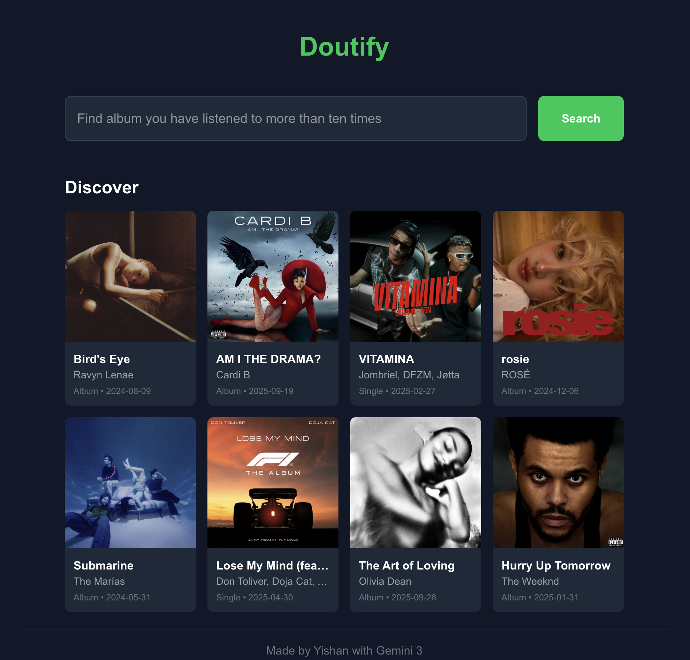

# Doutify — Music Album Explorer

> **English** | [简体中文](./README.zh-CN.md)

<p align="center">
  
</p>

Doutify is a music album exploration platform designed to make it quick and easy to look up album information — especially when you are adding a new music album entry on [Douban Music](https://music.douban.com/). All album metadata is powered by the [Spotify Web API](https://developer.spotify.com/documentation/web-api), fetched server-side and proxied through Next.js API routes.

## ✨ Features

- 🔍 **Smart Search & Direct Link Jump** — Debounced live search with album type filters (`All` / `Albums` / `Singles & EPs`), release date sorting, pagination (10 results per page), `⌘K` / `/` search shortcuts, and instant Spotify album URL / URI detection (`open.spotify.com/album/...` or `spotify:album:...`).
- 💿 **Album Details & Archival Metadata** — View complete album metadata: high-resolution cover art, artists, record label, release date, multi-disc track grouping, explicit markers, UPC / EAN barcodes, copyrights, and Spotify links.
- 📋 **Copy, Download & Douban Workflow** — One-click `Copy All Info`, `Copy Tracklist`, `Copy Timed List`, individual metadata chips, per-track title copy, direct cover art download, and `Search Douban` / `Add to Douban` shortcuts.
- 🎧 **Album & Per-Track Audio Preview** — Play either the full album or any individual track inline via Spotify embeds.
- 🆕 **Daily New Releases & Curated Playlist** — Fresh releases aggregated daily (24h revalidation) from Spotify `tag:new` album search combined with a live curated Spotify playlist (`playlist_cache.json` fallback), filterable on [/new](./app/new/page.tsx) and [/discover](./app/discover/page.tsx).
- ★ **Saved Crate & Recently Viewed** — Bookmark albums into a persistent local Saved Crate and revisit up to 5 recently inspected albums right from the homepage.
- 🎨 **Obsidian Editorial UI** — Minimalist `#050505` dark interface built with [Tailwind CSS](https://tailwindcss.com/) and `Instrument Serif` + `Geist` + `Geist Mono` typography.

## 🛠 Tech Stack

| Layer      | Technology |
| ---------- | ---------- |
| Framework  | [Next.js 16](https://nextjs.org/) (App Router) |
| UI Library | [React 19](https://react.dev/) |
| Language   | [TypeScript](https://www.typescriptlang.org/) |
| Styling    | [Tailwind CSS 4](https://tailwindcss.com/) + [@tailwindcss/typography](https://github.com/tailwindlabs/tailwindcss-typography) |
| Data Source| [Spotify Web API](https://developer.spotify.com/documentation/web-api) (Client Credentials Flow) |
| Markdown   | [react-markdown](https://github.com/remarkjs/react-markdown) |
| Hosting    | [Vercel](https://vercel.com/) with [Analytics](https://vercel.com/docs/analytics) & [Speed Insights](https://vercel.com/docs/speed-insights) |

## 🚀 Getting Started

### Prerequisites

- [Node.js](https://nodejs.org/) 18.18+ (or the version required by your Next.js release)
- A free [Spotify Developer](https://developer.spotify.com/dashboard) app (Client Credentials flow only — no user authorization needed)

### Setup

```bash
# 1. Install dependencies
npm install

# 2. Create a Spotify app and copy your credentials
#    (Dashboard → Your app → Settings → Client ID / Client Secret)

# 3. Configure environment variables
cp .env.local.example .env.local   # or create .env.local
```

`.env.local`:

```env
SPOTIFY_CLIENT_ID=your_client_id
SPOTIFY_CLIENT_SECRET=your_client_secret
```

### Run locally

```bash
npm run dev      # start the dev server at http://localhost:3000
npm run build    # production build
npm run start    # serve the production build
npm run lint     # run ESLint
```

## 🗂 Project Structure

```
album-info/
├── app/                        # Next.js App Router (pages + API routes)
│   ├── page.tsx                # Home: live search, link detector, Saved Crate, Recently Viewed, New Releases
│   ├── not-found.tsx           # Editorial 404 page
│   ├── album/[id]/
│   │   ├── page.tsx            # Album detail, track preview, Douban copy & shortcuts
│   │   └── loading.tsx         # Album detail loading skeleton
│   ├── new/
│   │   ├── page.tsx            # Daily New Releases page with type filters
│   │   └── loading.tsx         # New releases loading skeleton
│   ├── discover/
│   │   ├── page.tsx            # Curated playlist page (server component)
│   │   ├── DiscoverClient.tsx  # Filterable playlist table UI
│   │   ├── loading.tsx         # Playlist loading skeleton
│   │   └── playlist_cache.json # Local fallback cache of playlist data
│   ├── privacy/page.tsx        # Privacy policy page (renders PRIVACY_POLICY.md)
│   ├── components/             # Header, Footer, FadeImage, NewReleases
│   └── api/spotify/            # Server-side proxy to the Spotify Web API
│       ├── search/route.ts
│       ├── album/[id]/route.ts
│       ├── artist/[id]/albums/route.ts
│       ├── playlist/[id]/route.ts
│       └── new-releases/route.ts
├── components/
│   └── AlbumCard.tsx           # Reusable album card component
├── lib/
│   ├── spotify.ts              # Spotify Client Credentials cache & schema normalizers
│   ├── recentAlbums.ts         # LocalStorage Recently Viewed shelf helpers
│   └── savedAlbums.ts          # LocalStorage Saved Crate helpers
└── PRIVACY_POLICY.md           # Source of the privacy policy page
```

## 🔌 API Routes

All routes proxy to the [Spotify Web API](https://developer.spotify.com/documentation/web-api) server-side so credentials never leak to the client.

| Route | Description |
| ----- | ----------- |
| `GET /api/spotify/search?q=&type=&limit=&offset=` | Search albums & artists (clamped to Development Mode limits) |
| `GET /api/spotify/album/[id]` | Album details with multi-page track pagination (>50 tracks supported) |
| `GET /api/spotify/artist/[id]/albums` | Latest releases by an artist (top 6) |
| `GET /api/spotify/playlist/[id]` | Spotify playlist details |
| `GET /api/spotify/new-releases` | Daily refreshed hybrid feed (`tag:new` album search + live playlist, with `/browse/new-releases` and local cache fallbacks) |

## ☁️ Deployment

The project is ready to deploy on [Vercel](https://vercel.com/):

```bash
vercel
```

Set `SPOTIFY_CLIENT_ID` and `SPOTIFY_CLIENT_SECRET` as environment variables in your Vercel project settings. [Vercel Analytics](https://vercel.com/docs/analytics) and [Speed Insights](https://vercel.com/docs/speed-insights) are already wired up in [`app/layout.tsx`](./app/layout.tsx).

## 🔒 Privacy

We take privacy seriously — no personal data is collected or stored. See the [Privacy Policy](./PRIVACY_POLICY.md) or the rendered `app/privacy/page.tsx` page for details.

## 🤝 Related

- [Chinese README](./README.zh-CN.md) (简体中文)
- [Spotify Web API Documentation](https://developer.spotify.com/documentation/web-api)
- [Douban Music](https://music.douban.com/)
