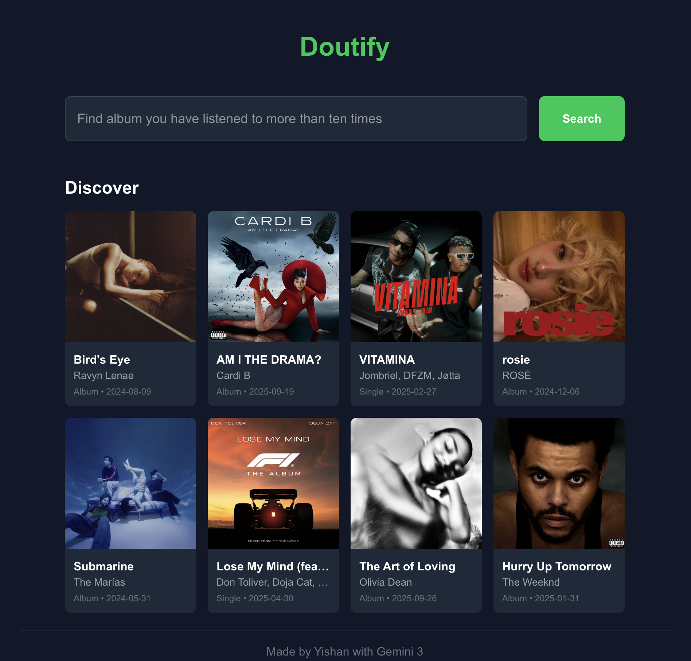

# Doutify — 音乐专辑探索平台

> [English](./README.md) | **简体中文**

<p align="center">
  
</p>

Doutify 是一个音乐专辑探索平台，主要用于在为 [豆瓣音乐](https://music.douban.com/) 添加专辑条目时快速查询专辑信息。所有专辑元数据均来自 [Spotify Web API](https://developer.spotify.com/documentation/web-api)，由服务端统一获取，并通过 Next.js API 路由代理给前端，凭证不会暴露给客户端。

## ✨ 主要功能

- 🔍 **智能搜索** — 支持按专辑和艺术家搜索，分页展示（每页 10 条），可按发行日期排序（最新 / 最旧 / 相关度）。
- 💿 **专辑详情** — 查看完整的专辑信息：封面、艺术家、唱片公司、发行日期、热度、风格流派、外部 ID（UPC / ISRC 等）以及 Spotify 链接。
- 📋 **复制与下载** — 一键复制专辑名、艺术家、唱片公司、发行日期、外部 ID、Spotify 链接或完整曲目列表；详情页可直接下载封面图。
- 🆕 **新碟速递** — 基于精选公开 Spotify 歌单展示最新发行的专辑，本地缓存 5 天；也可在[发现页](./app/discover/page.tsx)浏览完整歌单，或前往专门的[新碟页面](./app/new/page.tsx)。
- 🎵 **曲目列表** — 完整曲目列表，含每首曲目时长，支持一键复制。
- 🔗 **相关专辑** — 每个专辑详情页的「Discovery」板块会展示同一艺术家的其他发行作品。
- 🎨 **现代 UI** — 基于 [Tailwind CSS](https://tailwindcss.com/) 构建的响应式深色模式界面，使用 [Geist](https://vercel.com/font) 字体。

## 🛠 技术栈

| 分层      | 技术 |
| ---------- | ---------- |
| 框架  | [Next.js 16](https://nextjs.org/)（App Router） |
| UI 库 | [React 19](https://react.dev/) |
| 语言   | [TypeScript](https://www.typescriptlang.org/) |
| 样式    | [Tailwind CSS 4](https://tailwindcss.com/) + [@tailwindcss/typography](https://github.com/tailwindlabs/tailwindcss-typography) |
| 数据源| [Spotify Web API](https://developer.spotify.com/documentation/web-api)（Client Credentials 流程） |
| Markdown   | [react-markdown](https://github.com/remarkjs/react-markdown) |
| 托管    | [Vercel](https://vercel.com/)，集成 [Analytics](https://vercel.com/docs/analytics) 与 [Speed Insights](https://vercel.com/docs/speed-insights) |

## 🚀 快速开始

### 环境要求

- [Node.js](https://nodejs.org/) 18.18+（或与你的 Next.js 版本对应的要求）
- 一个免费的 [Spotify Developer](https://developer.spotify.com/dashboard) 应用（仅需 Client Credentials 流程，无需用户授权）

### 安装配置

```bash
# 1. 安装依赖
npm install

# 2. 创建 Spotify 应用并复制凭证
#    （Dashboard → 你的应用 → Settings → Client ID / Client Secret）

# 3. 配置环境变量
cp .env.local.example .env.local   # 或手动创建 .env.local
```

`.env.local`：

```env
SPOTIFY_CLIENT_ID=你的_client_id
SPOTIFY_CLIENT_SECRET=你的_client_secret
```

### 本地运行

```bash
npm run dev      # 启动开发服务器，访问 http://localhost:3000
npm run build    # 生产构建
npm run start    # 运行生产构建
npm run lint     # 运行 ESLint
```

## 🗂 项目结构

```
album-info/
├── app/                        # Next.js App Router（页面 + API 路由）
│   ├── page.tsx                # 首页：搜索 + Discover（新碟速递）
│   ├── album/[id]/page.tsx     # 专辑详情页
│   ├── new/page.tsx            # 新碟页面
│   ├── discover/
│   │   ├── page.tsx            # 精选歌单页（服务端组件）
│   │   ├── DiscoverClient.tsx  # 歌单表格 UI
│   │   └── playlist_cache.json # 歌单数据本地缓存（5 天）
│   ├── privacy/page.tsx        # 隐私政策页（渲染 PRIVACY_POLICY.md）
│   ├── components/             # Footer、NewReleases
│   └── api/spotify/            # Spotify Web API 服务端代理
│       ├── search/route.ts
│       ├── album/[id]/route.ts
│       ├── artist/[id]/albums/route.ts
│       ├── playlist/[id]/route.ts
│       └── new-releases/route.ts
├── components/
│   └── AlbumCard.tsx           # 可复用的专辑卡片组件
├── lib/
│   └── spotify.ts              # Spotify 认证（client credentials 流程）
└── PRIVACY_POLICY.md           # 隐私政策页的内容来源
```

## 🔌 API 路由

所有路由都在服务端代理 [Spotify Web API](https://developer.spotify.com/documentation/web-api) 请求，凭证不会泄露到客户端。

| 路由 | 说明 |
| ----- | ----------- |
| `GET /api/spotify/search?q=&type=&limit=&offset=` | 搜索专辑与艺术家 |
| `GET /api/spotify/album/[id]` | 专辑详情（曲目、唱片公司、外部 ID 等） |
| `GET /api/spotify/artist/[id]/albums` | 艺术家的最新专辑（前 6 张） |
| `GET /api/spotify/playlist/[id]` | Spotify 歌单详情 |
| `GET /api/spotify/new-releases` | 基于缓存的歌单生成新碟列表（支持回退到官方新发行接口与单张查询） |

## ☁️ 部署

项目已为 [Vercel](https://vercel.com/) 部署做好准备：

```bash
vercel
```

在 Vercel 项目设置中将 `SPOTIFY_CLIENT_ID` 和 `SPOTIFY_CLIENT_SECRET` 配置为环境变量。[Vercel Analytics](https://vercel.com/docs/analytics) 和 [Speed Insights](https://vercel.com/docs/speed-insights) 已在 [`app/layout.tsx`](./app/layout.tsx) 中接入。

## 🔒 隐私

我们非常重视隐私 — 本应用不收集、不存储任何个人数据。详见[隐私政策](./PRIVACY_POLICY.md)或站内由 `app/privacy/page.tsx` 渲染的隐私政策页面。

## 🤝 相关链接

- [English README](./README.md)（英文版）
- [Spotify Web API 文档](https://developer.spotify.com/documentation/web-api)
- [豆瓣音乐](https://music.douban.com/)
